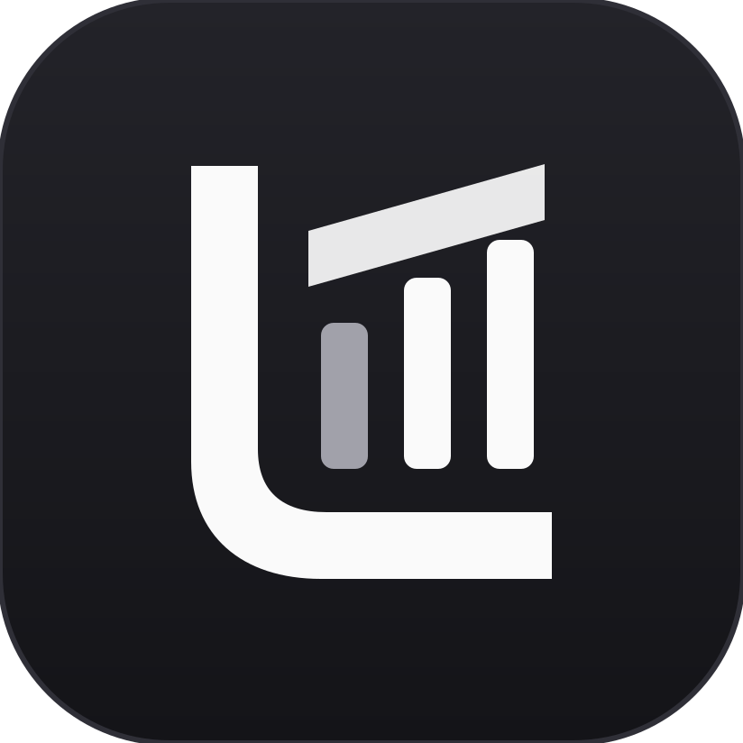
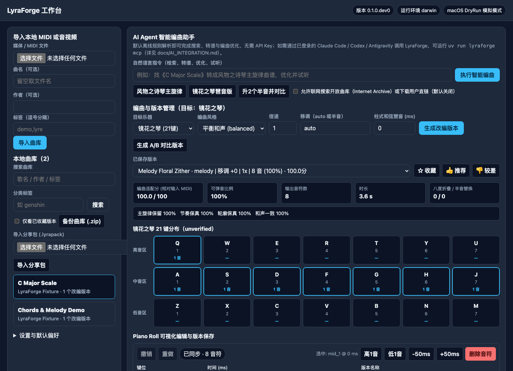

<div align="center">



<h1>LyraForge</h1>

<p><strong>将 MIDI 和音频转换为游戏内自由演奏乐器可用的曲谱</strong></p>

<p>
  <a href="LICENSE"></a>
  <a href="https://github.com/PariyaProject/LyraForge/actions/workflows/ci.yml"></a>
  <a href="https://github.com/PariyaProject/LyraForge/releases/tag/dev-latest"></a>
  
</p>

<p>
  <a href="#快速开始">快速开始</a> ·
  <a href="#核心功能">核心功能</a> ·
  <a href="#平台兼容与使用限制">平台兼容</a> ·
  <a href="#相关文档">相关文档</a>
</p>

</div>

LyraForge 是一款基于 **GNU GPL-3.0** 协议开源的跨平台桌面音乐转谱与游戏乐器编曲工作台，面向《原神》PC 版大世界中的**自由乐器演奏界面**（非下落式音游脚本）。你可以导入 MIDI 或音频、适配游戏乐器 21 键范围、在交互式 Piano Roll 中试听与微调，并保存到本地曲库或导出分享。



> 查看全套 6 视图实机截图：
> [首页](docs/assets/ui/home.png) ·
> [本地曲库](docs/assets/ui/library.png) ·
> [音频转谱](docs/assets/ui/transcribe.png) ·
> [编曲工作室 & Piano Roll](docs/assets/ui/studio.png) ·
> [试听与演奏](docs/assets/ui/playback.png) ·
> [设置与 MCP 接入](docs/assets/ui/settings.png)

---

## 核心功能

- **深色专业桌面工作台**：固定底部全局试听传输栏支持跨视图持续试听 WAV 并随时暂停、继续与急停，整合首页、本地曲库、音频转谱、Piano Roll 工作室、演奏控制台与设置六大工作区。
- **多格式曲谱与媒体导入**：原生支持本地 `.mid` / `.midi` 与 `.wav`；在设置中安装或接入 `ffmpeg` 后，可提取常见音频（`MP3 / FLAC / OGG / M4A / AAC / OPUS` 等）与视频/分段容器（`MP4 / MKV / MOV / WebM / M4S` 等，实际解码取决于本机 FFmpeg，不支持加密/DRM 文件）。也支持由用户明确确认后检索 Internet Archive 开放许可条目或通过公开直链导入合法素材。
- **音频转谱与独立评价**：内置零外部依赖单音识别引擎（`builtin-mono` YIN）用于干净独奏旋律，并支持在设置中一键安装开源多音转录引擎（`basic-pitch` / `dettato`）及 GPU 加速（NVIDIA CUDA / Apple MPS）；编曲报告将“可演奏适配度”与“转录还原度”分开展示，便于客观判断效果。
- **面向游戏乐器的智能编曲**：内置**风物之诗琴**、**镜花之琴**与**老旧的诗琴**预设（均 21 键），支持主旋律识别与优先保留、自动移调寻优、八度折叠、半音策略调整以及柱式和弦自动琶音；每件乐器提供主旋律 / 均衡 / 丰满 / 慢速练习 / 轻快等**一键预设**，无需任何 Agent 或 API 调用。
- **DAW 级 Piano Roll 编辑与离线 WAV 试听**：提供 21 键位热力图、时间轴缩放、网格吸附、拖拽调整音高与拍点、点击增删音符、撤销/重做与版本对比，并利用纯 Python 拨弦合成器离线渲染 WAV，在不打开游戏的情况下即可试听效果。
- **本地曲库、`.lyrapack` 分享与安全备份**：内置本地曲库，支持标签筛选、收藏与多版本对比管理；支持导出标准 MIDI、`performance.json` 与不包含原始音频或个人凭据的 `.lyrapack` 分享包，以及全库 ZIP 一键备份与安全恢复。
- **安全游戏演奏控制（Windows）**：仅面向大世界自由演奏界面，采用准备/授权两步确认机制、前景窗口焦点校验与 `Esc` 紧急停键全松键，不读取、挂钩或修改游戏内存；macOS 下默认使用零按键的 `DryRun` 模拟模式。开始演奏后会先进入「等待游戏窗口」状态（默认 10 秒），检测到游戏前置再发送按键；若游戏以管理员运行，LyraForge 也需要以管理员身份启动（界面会自动检测并提示一键重启）。可在设置中配置**默认不绑定**的全局热键（开始/暂停/继续/停止/切歌），游戏内直接控制。
- **可选的 AI / MCP 集成**：常规导入、转谱、编曲、试听与导出均可 100% 离线完成，无需 AI 或 API Key；如需联动外部 AI 客户端，可在设置的高级选项中通过本地 `lyraforge mcp` 接入 Claude Code / Codex / Antigravity / DeepSeek，或配置 OpenAI 兼容端点，详见 [AI 与 MCP 集成手册](docs/AI_INTEGRATION.md)。

---

## 快速开始

### 预发行便携构建（Windows 10/11 & macOS Apple Silicon，免安装 Python / Node）

- **最新开发构建（Pre-release）**：[Latest Dev Pre-release (`dev-latest`)](https://github.com/PariyaProject/LyraForge/releases/tag/dev-latest)（查看全部历史预发行与正式版本请前往 [Releases](https://github.com/PariyaProject/LyraForge/releases)）。

#### Windows 10/11 x64（`LyraForge-dev-*-windows-x64.zip`）

1. 下载 `LyraForge-dev-*-windows-x64.zip` 并解压（保持 `LyraForge.exe` 与 `_internal\` 位于同一解压目录）。
2. 双击 `LyraForge.exe` 启动桌面工作台；默认会请求管理员权限（UAC）以匹配游戏权限，且以无控制台窗口模式静默调用后台工具（Windows 11 已内置 Edge WebView2 Runtime；Windows 10 如缺少请安装 Evergreen Runtime）。源码调试如需跳过提权可传 `--no-elevate` 或设置 `LYRAFORGE_NO_ELEVATE=1`。
3. 若双击后没有出现窗口，启动详情会写入 `%LOCALAPPDATA%\LyraForge\logs\startup.log` 并弹出原生错误对话框，提交 Issue 时请附上该日志。

<details>
<summary>可选：校验文件哈希与命令行自检</summary>

```powershell
Get-FileHash .\LyraForge-dev-*-windows-x64.zip -Algorithm SHA256
Get-Content .\SHA256SUMS.txt
.\LyraForge\LyraForge.exe --self-check --check-gui
.\LyraForge\LyraForge.exe
```

</details>

#### macOS Apple Silicon（`LyraForge-dev-*-macos-arm64.zip`）

1. 下载 `LyraForge-dev-*-macos-arm64.zip` 并解压，将 `LyraForge.app` 拖入 `/Applications`（或任意可写目录）。
2. 开源预发行版暂未做 Apple 开发者公证，首次打开若受系统 Gatekeeper 拦截提示，可在终端放行后启动：
   ```bash
   xattr -dr com.apple.quarantine LyraForge.app
   open LyraForge.app
   ```
3. macOS 原生支持曲库、音频转谱、Piano Roll 编曲、离线 WAV 试听与 MCP 集成；游戏按键演奏保留为安全的 **DryRun 模拟模式**。

<details>
<summary>可选：校验文件哈希</summary>

```bash
shasum -a 256 -c SHA256SUMS.txt --ignore-missing
unzip LyraForge-dev-*-macos-arm64.zip
```

</details>

- **可选外置工具与 GPU 加速（Windows & macOS 通用）**：如需提取非 WAV 音视频或使用多音 AI 转谱，打开桌面 **设置 →「转谱引擎与 GPU」** 一键安装 `ffmpeg`、`basic-pitch` 或 `dettato` 即可（Windows NVIDIA 显卡用户也可在同页面一键安装 CUDA 版 PyTorch 开启加速）；工具会隔离安装至用户数据目录，不修改系统环境变量，命令行等价入口为 `lyraforge tools install`。

### 从源码运行（macOS Apple Silicon / Windows）

前置环境：Python `3.11` 或 `3.12`、[`uv`](https://docs.astral.sh/uv/)；运行桌面前端还需 Node.js `22+` 与 `pnpm`（`12.6.0`）。

```bash
# 1. 克隆仓库并安装依赖（--extra desktop 用于启动桌面应用窗口）
git clone https://github.com/PariyaProject/LyraForge.git
cd LyraForge
uv sync --extra desktop

# 2. 快速体验命令行：查看内置乐器，并导入示例 MIDI
uv run lyraforge profiles list
uv run lyraforge import tests/fixtures/midi/chords_type1.mid --title "Chords Demo"

# 3. 构建前端并启动桌面工作台
pnpm --dir apps/desktop/web install --frozen-lockfile
pnpm --dir apps/desktop/web build
uv run --extra desktop lyraforge desktop
```

如果你只想以 `stdio` MCP Server 形式连接现有 AI 客户端：

```bash
uv sync
uv run lyraforge mcp
```

更多 CLI 命令、测试门禁、Windows / macOS 便携打包以及外置 `ffmpeg` / `basic-pitch` / `dettato` 配置方式，请查看 [开发者文档](docs/DEVELOPMENT.md)。

---

## 平台兼容与使用限制

| 平台 | 转谱、编曲、Piano Roll、曲库与 MCP | 游戏内自由演奏模式 |
|---|---|---|
| **macOS Apple Silicon** | 支持 | 仅支持 **DryRun** 虚拟试跑，不触发系统级按键 |
| **Windows 10/11 x64** | 支持 | **支持**（已在 Windows 10/11《原神》自由演奏实机验证；游戏以管理员运行时需匹配权限） |

开始使用前请了解以下真实限制：

- **复杂音频转谱存在客观上限**：内置 `builtin-mono` 仅适合干净的单音独奏；流行歌曲、人声与伴奏混音或密集多声部和弦音频，可在设置中一键安装 `ffmpeg` 与开源多音引擎（`basic-pitch` / `dettato`，支持 GPU 加速）并在 Piano Roll 中手工校音微调，复杂混音仍无法保证一键完整还原原曲。
- **外置媒体与识别模型按需安装**：出于许可证与安装包体积考虑，预发行压缩包不直接捆绑 `ffmpeg` 与神经网络权重文件，用户可在 **设置 →「转谱引擎与 GPU」** 按需一键安装或手工配置。
- **游戏键盘自动化风险**：Windows 游戏内演奏仅在用户主动触发并保持游戏前台窗口时发送常规扫描码输入；**任何第三方自动按键工具均不能保证 100% 账号零风险**，请自行遵守游戏服务条款与适用法规，切勿用于下落式音游活动或任何合规受限场景。

---

## 相关文档

| 文档 | 内容说明 |
|---|---|
| [开发者文档](docs/DEVELOPMENT.md) | 完整 CLI 工具链、外置识别引擎与 GPU 配置、安全架构要点及 Windows / macOS 打包 |
| [AI 与 MCP 集成手册](docs/AI_INTEGRATION.md) | 无需 API Key 的 MCP Server、`integrations/` 模板及权限边界说明 |
| [系统架构设计](docs/ARCHITECTURE.md) | 跨平台核心分层、桌面宿主及 Windows 驱动隔离原则 |
| [UI 设计规范](DESIGN.md) | Studio Obsidian 视觉系统、Token、布局网格与桌面可访问性约束 |
| [产品路线图](docs/ROADMAP.md) | 里程碑完成情况与后续演进方向（转谱效果优化与正式发版） |
| [变更记录](CHANGELOG.md) | 面向用户的版本与功能更新记录 |

> 工程进度、实测记录与维护规范：[开发进度总览](docs/PROGRESS.md) · [测试报告与基准](docs/TEST_REPORT.md) · [项目维护工作流](docs/MAINTAINER_WORKFLOW.md)

---

## 开源协议与参与贡献

- **开源协议**：本项目基于 **GNU General Public License v3.0 (GPL-3.0)** 开源，完整条款见 [LICENSE](LICENSE)，第三方组件与授权审计见 [docs/LICENSE_AUDIT.md](docs/LICENSE_AUDIT.md)。
- **版权与隐私声明**：请仅导入、转谱和分享你拥有合法使用权限的音频或 MIDI 素材；在线开放目录的元数据由外部来源填写，使用前请自行核实词曲、录音与改编授权。
- **参与贡献**：欢迎提交 [Issues](https://github.com/PariyaProject/LyraForge/issues) 与 Pull Request。提交改动前请先阅读 [AGENTS.md](AGENTS.md) 与 [docs/DEVELOPMENT.md](docs/DEVELOPMENT.md)，切勿上传 API Key、个人 OAuth 凭据或受版权保护的音频文件。

*LyraForge 为独立开源社区项目，与米哈游 / HoYoverse 及各第三方 AI 提供商无官方关联。*
